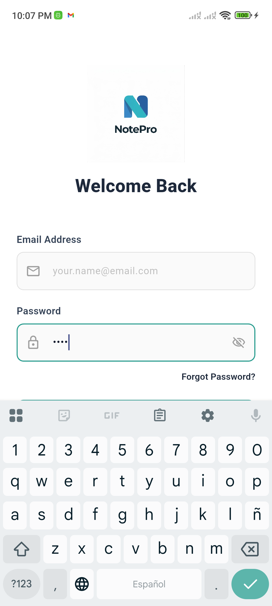

# 📝 Notas Pro

Aplicación móvil de **notas y recordatorios** construida con **Flutter** y respaldada por un backend **Spring Boot**. Permite a los usuarios crear, organizar y gestionar notas con texto enriquecido, imágenes, etiquetas y colores personalizados, además de programar recordatorios con notificaciones locales.



---

## Tabla de Contenidos

- [Características](#características)
- [Arquitectura](#arquitectura)
- [Estructura del Proyecto](#estructura-del-proyecto)
- [Tecnologías y Dependencias](#tecnologías-y-dependencias)
- [Requisitos Previos](#requisitos-previos)
- [Instalación y Configuración](#instalación-y-configuración)
- [Configuración del Backend](#configuración-del-backend)
- [Ejecución](#ejecución)
- [Modelos de Datos](#modelos-de-datos)
- [API Endpoints](#api-endpoints)
- [Gestión de Estado](#gestión-de-estado)
- [Sistema de Notificaciones](#sistema-de-notificaciones)
- [Roles y Permisos](#roles-y-permisos)
- [Personalización](#personalización)
- [Contribución](#contribución)
- [Licencia](#licencia)

---

## Características

### Usuarios
- **Registro y autenticación** con verificación de correo electrónico
- **Login con JWT** (access token + refresh token automático)
- **Recuperación de contraseña** por correo electrónico
- **Edición de perfil** (nombre, email, contraseña)
- **Eliminación de cuenta**

### Notas
- **Crear, editar y eliminar** notas con editor de texto enriquecido
- **Formato de texto**: negrita, cursiva, subrayado, tachado, encabezados, listas y citas
- **Inserción de imágenes** desde cámara o galería
- **Colores de fondo** personalizados por nota
- **Etiquetas** para categorizar notas
- **Anclar notas** (fijadas arriba) — individual o en lote
- **Estados de nota**: Activa, Archivada, Eliminada (papelera)
- **Compartir notas** como texto plano
- **Búsqueda y filtrado** por texto, etiquetas y estado
- **Selección múltiple** para operaciones en lote

### Recordatorios (Tareas)
- **Crear recordatorios** asociados a notas existentes
- **Prioridad**: Alta, Media, Baja
- **Marcar como completado** / pendiente
- **Reprogramar** fecha y hora
- **Notificaciones locales**: 1 hora antes, en el momento exacto, y 2 horas después si no se completa

### Ajustes
- **Tema**: Claro, Oscuro, Automático (sistema)
- **Color de acento** personalizable (Teal, Azul, Violeta, Mostaza, Rojo, Verde)
- **Notificaciones**: activar/desactivar
- **Exportar notas** como texto
- **Vaciar papelera**

### Administración (solo ADMIN / SUPER_ADMIN)
- **Listar todos los usuarios** del sistema
- **Crear cuentas de administrador** (solo SUPER_ADMIN)
- **Cambiar roles** de usuarios
- **Eliminar usuarios**

---

## Arquitectura

La aplicación sigue una arquitectura **Feature-First** con separación clara por capas:

```
┌─────────────────────────────────────────────────┐
│                  Presentación                    │
│         (Screens, Widgets, Providers)            │
├─────────────────────────────────────────────────┤
│                    Dominio                        │
│               (Modelos / Entidades)               │
├─────────────────────────────────────────────────┤
│                     Datos                         │
│       (Services, ApiClient, MockRepository)       │
├─────────────────────────────────────────────────┤
│               Backend (Spring Boot)               │
│           REST API + PostgreSQL + JWT             │
└─────────────────────────────────────────────────┘
```

**Patrón de estado:** [Riverpod 3.x](https://riverpod.dev/) con `Notifier` / `AsyncNotifier`.

---

## Estructura del Proyecto

```
lib/
├── main.dart                           # Punto de entrada de la aplicación
├── core/
│   ├── config/
│   │   └── app_config.dart             # URL base del backend
│   ├── enums/
│   │   ├── estado_note_type.dart       # Estados de nota (ACTIVA, ARCHIVADA, ELIMINADA)
│   │   └── role_type.dart              # Roles de usuario (USER, ADMIN, SUPER_ADMIN)
│   ├── network/
│   │   ├── api_client.dart             # Cliente HTTP con auto-refresh de JWT
│   │   ├── mock_repository.dart        # Datos de prueba para desarrollo sin backend
│   │   └── services/
│   │       ├── admin_service.dart      # Servicio de administración de usuarios
│   │       ├── auth_service.dart       # Servicio de autenticación (login, registro, etc.)
│   │       ├── notas_service.dart      # CRUD de notas
│   │       ├── recordatorios_service.dart  # CRUD de recordatorios
│   │       └── usuario_service.dart    # Perfil y cuenta del usuario
│   ├── presentation/
│   │   └── screens/
│   │       └── splash_screen.dart      # Pantalla de carga inicial
│   ├── services/
│   │   └── notification_service.dart   # Notificaciones locales programadas
│   ├── utils/
│   │   ├── app_snackbar.dart           # Toasts/snackbars globales
│   │   ├── excepciones.dart            # Manejo de excepciones personalizadas
│   │   └── note_preview.dart           # Previsualización de notas en listas
│   └── widgets/
│       ├── custom_date_picker.dart     # Selector de fecha personalizado
│       └── custom_time_picker.dart     # Selector de hora personalizado
├── features/
│   ├── admin/
│   │   └── presentation/screens/
│   │       ├── admin_screen.dart       # Panel de administración
│   │       └── users_list_screen.dart  # Lista de usuarios del sistema
│   ├── auth/
│   │   ├── domain/
│   │   │   └── usuario_model.dart      # Modelo de usuario
│   │   └── presentation/
│   │       ├── providers/
│   │       │   └── auth_provider.dart  # Estado de autenticación (Riverpod)
│   │       └── screens/
│   │           ├── login_screen.dart           # Inicio de sesión
│   │           ├── register_screen.dart        # Registro de cuenta
│   │           ├── forgot_password_screen.dart # Olvidé mi contraseña
│   │           └── reset_password_screen.dart  # Restablecer contraseña
│   ├── dashboard/
│   │   └── presentation/screens/
│   │       ├── dashboard_screen.dart   # Pantalla principal con resumen
│   │       └── main_layout.dart        # Layout con barra de navegación inferior
│   ├── notes/
│   │   ├── domain/
│   │   │   └── nota_model.dart         # Modelo de nota
│   │   └── presentation/
│   │       ├── providers/
│   │       │   └── notes_provider.dart # Estado de notas (Riverpod)
│   │       ├── screens/
│   │       │   ├── add_edit_note_screen.dart    # Editor de notas (v1)
│   │       │   ├── add_edit_note_screen_v2.dart # Editor de notas (v2 actual)
│   │       │   └── notes_list_screen.dart       # Lista de notas
│   │       └── widgets/
│   │           └── note_editor/
│   │               ├── active_text_block.dart    # Bloque de texto activo (editable)
│   │               ├── format_toolbar.dart       # Barra de formato de texto
│   │               ├── image_block.dart          # Bloque de imagen
│   │               ├── inactive_block.dart       # Bloque de texto inactivo
│   │               ├── controller/
│   │               │   └── note_editor_controller.dart  # Controlador del editor
│   │               ├── models/
│   │               │   ├── note_block.dart           # Modelo de bloque de nota
│   │               │   └── rich_text_controller.dart  # Controlador de texto enriquecido
│   │               └── serializer/
│   │                   └── note_serializer.dart       # Serialización de bloques
│   ├── reminders/
│   │   ├── domain/
│   │   │   └── recordatorio_model.dart   # Modelo de recordatorio
│   │   └── presentation/
│   │       ├── providers/
│   │       │   └── reminders_provider.dart  # Estado de recordatorios (Riverpod)
│   │       └── screens/
│   │           ├── add_reminder_screen.dart     # Crear recordatorio
│   │           └── reminders_list_screen.dart   # Lista de recordatorios
│   └── settings/
│       └── presentation/
│           ├── providers/
│           │   └── settings_provider.dart  # Estado de ajustes (Riverpod)
│           └── screens/
│               └── settings_screen.dart    # Pantalla de ajustes
```

---

## Tecnologías y Dependencias

| Dependencia | Versión | Descripción |
|---|---|---|
| **Flutter** | SDK ^3.10.8 | Framework de UI multiplataforma |
| **flutter_riverpod** | ^3.2.1 | Gestión de estado reactiva |
| **http** | ^1.6.0 | Cliente HTTP para llamadas REST |
| **flutter_secure_storage** | ^9.2.4 | Almacenamiento seguro de tokens JWT |
| **shared_preferences** | ^2.5.4 | Persistencia de preferencias del usuario |
| **flutter_local_notifications** | ^18.0.1 | Notificaciones locales programadas |
| **timezone** | ^0.9.4 | Manejo de zonas horarias para notificaciones |
| **share_plus** | ^10.1.4 | Compartir contenido con otras apps |
| **image_picker** | ^1.1.2 | Selección de imágenes desde cámara/galería |
| **path_provider** | ^2.1.5 | Acceso a directorios del sistema |
| **font_awesome_flutter** | ^11.0.0 | Iconos adicionales |
| **flutter_localizations** | SDK | Localización en español |

---

## Requisitos Previos

- **Flutter SDK** >= 3.10.8
- **Dart SDK** >= 3.10.8
- **Android Studio** o **VS Code** con extensiones de Flutter
- **Backend Spring Boot** ejecutándose (ver [Configuración del Backend](#configuración-del-backend))
- **JDK 17+** (para el backend)
- **PostgreSQL** (para el backend)

---

## Instalación y Configuración

### 1. Clonar el repositorio

```bash
git clone https://github.com/dair7/notesapp_flutter.git
cd notesapp_flutter
```

### 2. Instalar dependencias

```bash
flutter pub get
```

### 3. Configurar la URL del backend

Editar `lib/core/config/app_config.dart`:

```dart
class AppConfig {
  // Desarrollo local (misma red Wi-Fi)
  static const String baseUrl = 'http://TU_IP_LOCAL:8080';

  // Producción
  // static const String baseUrl = 'https://tu-servidor.com';
}
```

### 4. Verificar el análisis estático

```bash
flutter analyze
```

---

## Configuración del Backend

La aplicación se conecta a un backend **Spring Boot** con las siguientes características:

- **Base de datos**: PostgreSQL
- **Autenticación**: JWT (access token + refresh token)
- **Verificación de email**: Envío de correo al registrarse
- **API REST**: Endpoints para notas, recordatorios, usuarios y administración

> **Nota:** El repositorio del backend no está incluido aquí. Asegúrate de que el backend esté ejecutándose y accesible antes de iniciar la app.

---

## Ejecución

### Desarrollo (Android)

```bash
flutter run
```

### Desarrollo (Web)

```bash
flutter run -d chrome
```

### Compilar APK

```bash
flutter build apk --release
```

### Compilar App Bundle (Play Store)

```bash
flutter build appbundle --release
```

---

## Modelos de Datos

### Usuario

| Campo | Tipo | Descripción |
|---|---|---|
| `id` | `int?` | Identificador único |
| `nombre` | `String` | Nombre del usuario |
| `email` | `String` | Correo electrónico |
| `password` | `String?` | Solo se envía al registrarse |
| `role` | `RoleType` | `USER`, `ADMIN`, `SUPER_ADMIN` |
| `estadoUsuario` | `String` | `ACTIVO` o `INACTIVO` |
| `createdAt` | `DateTime?` | Fecha de creación |

### Nota

| Campo | Tipo | Descripción |
|---|---|---|
| `id` | `int?` | Identificador único |
| `titulo` | `String` | Título de la nota |
| `contenido` | `String` | Contenido (texto enriquecido serializado) |
| `fechaCreacion` | `DateTime?` | Fecha de creación |
| `estado` | `EstadoNoteType` | `ACTIVA`, `ARCHIVADA`, `ELIMINADA` |
| `usuarioId` | `int?` | ID del propietario |
| `esAnclada` | `bool` | Si está fijada arriba |
| `color` | `String?` | Color de fondo en hex (ej: `#FFE5B4`) |
| `etiquetas` | `List<String>` | Etiquetas de categorización |

### Recordatorio

| Campo | Tipo | Descripción |
|---|---|---|
| `id` | `int?` | Identificador único |
| `fecha` | `DateTime` | Fecha y hora del recordatorio |
| `completado` | `bool` | Estado de completado |
| `notaId` | `int?` | ID de la nota asociada |
| `notaTitulo` | `String?` | Título de la nota asociada |
| `prioridad` | `Prioridad` | `ALTA`, `MEDIA`, `BAJA` |

---

## API Endpoints

### Autenticación (`/api/auth`)

| Método | Endpoint | Descripción |
|---|---|---|
| `POST` | `/login` | Iniciar sesión (devuelve JWT) |
| `POST` | `/register` | Registrar nuevo usuario |
| `POST` | `/forgot-password?email={email}` | Solicitar reset de contraseña |
| `POST` | `/reset-password` | Restablecer contraseña con token |
| `GET` | `/verify?token={token}` | Verificar email |
| `POST` | `/refresh-token` | Renovar access token |
| `POST` | `/logout` | Cerrar sesión (invalidar refresh token) |

### Notas (`/api/notas`)

| Método | Endpoint | Descripción |
|---|---|---|
| `POST` | `/{usuarioId}` | Crear nota |
| `GET` | `/usuario/{usuarioId}` | Obtener todas las notas del usuario |
| `GET` | `/usuario/{usuarioId}/estado/{estado}` | Filtrar notas por estado |
| `GET` | `/{notaId}` | Obtener una nota por ID |
| `PUT` | `/{notaId}` | Actualizar nota |
| `PUT` | `/{notaId}/estado?estado={ESTADO}` | Cambiar estado de nota |
| `PUT` | `/anclar?anclar={true\|false}` | Anclar/desanclar notas en lote |
| `DELETE` | `/{notaId}` | Eliminar nota permanentemente |

### Recordatorios (`/api/recordatorios`)

| Método | Endpoint | Descripción |
|---|---|---|
| `POST` | `/{notaId}` | Crear recordatorio para una nota |
| `GET` | `/usuario/{usuarioId}` | Obtener todos los recordatorios |
| `GET` | `/pendientes/usuario/{usuarioId}` | Solo recordatorios pendientes |
| `PUT` | `/{id}` | Actualizar fecha del recordatorio |
| `PUT` | `/{id}/completar` | Marcar como completado/pendiente |
| `DELETE` | `/{id}` | Eliminar recordatorio |

### Usuarios (`/api/usuarios`)

| Método | Endpoint | Descripción |
|---|---|---|
| `PUT` | `/{id}` | Actualizar perfil (nombre, email) |
| `PUT` | `/{id}/password` | Cambiar contraseña |
| `DELETE` | `/me` | Eliminar mi cuenta |

### Administración (`/api/admin`)

| Método | Endpoint | Descripción |
|---|---|---|
| `GET` | `/usuarios` | Listar todos los usuarios |
| `POST` | `/usuarios` | Crear admin (solo SUPER_ADMIN) |
| `PUT` | `/usuarios/{userId}/rol?rol={ROLE}` | Cambiar rol de usuario |
| `DELETE` | `/usuarios/{userId}` | Eliminar usuario |

---

## Gestión de Estado

La app utiliza **Riverpod 3.x** con los siguientes providers principales:

| Provider | Tipo | Descripción |
|---|---|---|
| `authProvider` | `NotifierProvider<AuthNotifier, AuthState>` | Estado de autenticación del usuario |
| `notesProvider` | `AsyncNotifierProvider<NotesNotifier, List<Nota>>` | Lista de notas del usuario |
| `remindersProvider` | `AsyncNotifierProvider<RemindersNotifier, List<Recordatorio>>` | Lista de recordatorios |
| `settingsProvider` | `NotifierProvider<SettingsNotifier, SettingsState>` | Preferencias de la app |
| `selectedTabProvider` | `NotifierProvider<SelectedTabNotifier, int>` | Tab activo en la navegación |
| `selectionModeProvider` | `NotifierProvider<SelectionModeNotifier, bool>` | Modo de selección múltiple |

### Flujo de autenticación

```
SplashScreen
    │
    ├── Token válido ──→ checkAuthStatus() ──→ MainLayout (Dashboard)
    │
    └── Sin token ─────→ LoginScreen
                              │
                              ├── Login exitoso ──→ MainLayout
                              ├── Registrarse ────→ RegisterScreen
                              └── Olvidé password → ForgotPasswordScreen
```

### Auto-refresh de tokens

El `ApiClient` intercepta respuestas `401/403` y automáticamente:
1. Solicita un nuevo access token usando el refresh token
2. Reintenta la petición original con el nuevo token
3. Evita refreshes concurrentes con un flag `_isRefreshing`

---

## Sistema de Notificaciones

La app programa **notificaciones locales** usando `flutter_local_notifications`:

| Notificación | Momento | Descripción |
|---|---|---|
| **Anticipada** | 1 hora antes | "Recordatorio en 1 hora" |
| **Exacta** | En el momento | "Tienes un recordatorio pendiente" |
| **Vencida** | 2 horas después | "Tarea sin completar" |

Al tocar una notificación, la app navega automáticamente a la pestaña de **Tareas**, tanto si la app está en primer plano como si fue terminada (cold start).

---

## Roles y Permisos

| Rol | Notas | Recordatorios | Admin Panel | Gestión Usuarios |
|---|---|---|---|---|
| `USER` | ✔ CRUD propias | ✔ CRUD propios | ✘ | ✘ |
| `ADMIN` | ✔ CRUD propias | ✔ CRUD propios | ✔ Ver usuarios | ✔ Cambiar roles |
| `SUPER_ADMIN` | ✔ CRUD propias | ✔ CRUD propios | ✔ Completo | ✔ Crear admins, eliminar |

La **barra de navegación inferior** se adapta al rol:
- **Usuario normal**: Dashboard, Notas, Tareas, Ajustes
- **Admin / Super Admin**: Dashboard, Usuarios, Admins, Ajustes

---

## Personalización

### Temas

La app soporta **Material 3** con tres modos de tema:
- **Claro** (`ThemeMode.light`)
- **Oscuro** (`ThemeMode.dark`)
- **Automático** (`ThemeMode.system`) — sigue la configuración del dispositivo

### Colores de acento

Seis colores predefinidos que modifican el `ColorScheme`:

| Color | Hex | Nombre |
|---|---|---|
| 🟢 | `#2A9D8F` | Teal (por defecto) |
| 🔵 | `#4A6FA5` | Azul |
| 🟣 | `#7B5EA7` | Violeta |
| 🟡 | `#B8860B` | Mostaza |
| 🔴 | `#E05C5C` | Rojo |
| 🟢 | `#4CAF50` | Verde |

Las preferencias se persisten con `SharedPreferences`.

---

## Contribución

1. Haz un fork del repositorio
2. Crea tu rama de feature (`git checkout -b feature/nueva-funcionalidad`)
3. Haz commit de tus cambios (`git commit -m 'Agregar nueva funcionalidad'`)
4. Push a la rama (`git push origin feature/nueva-funcionalidad`)
5. Abre un Pull Request

---

## Licencia

Este proyecto es de uso privado. Contacta al propietario del repositorio para más información.
